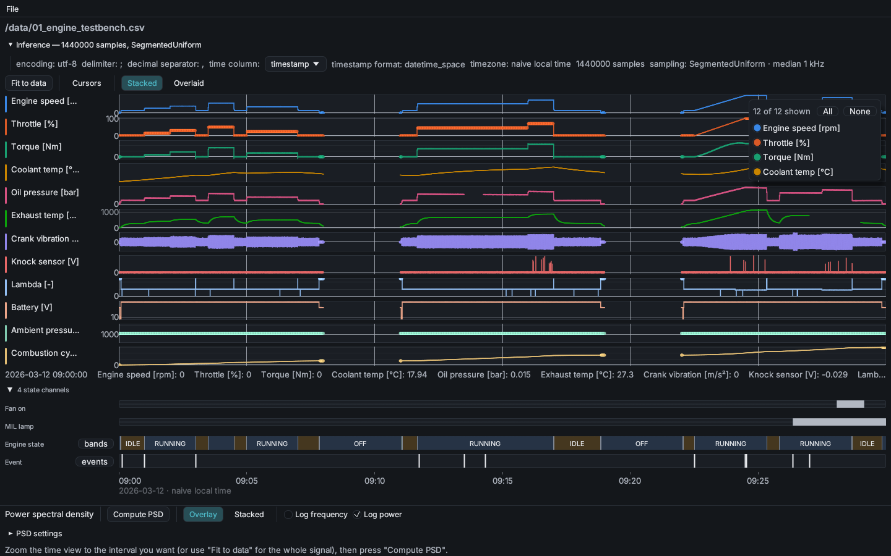

<h1 align="center">Glyde</h1>

<em>Glide through your time series.</em>

  

**Glyde** opens a file of measurements over time and lets you look at it straight away:
scroll, zoom, compare channels, read exact values, compute a spectrum. However big the
file is, and however messy.

No configuration panels. No plotting scripts. Drop the file in and look at your data.

## What it does

- **Opens what you have**: CSV, TSV and TXT with any delimiter, any decimal separator and
  the common encodings, units in the headers, ragged rows; Parquet files and folders of
  Parquet files.
- **Handles size**: a file larger than your memory opens too. The first part of the plot
  appears in seconds while the rest is read, and Glyde never uses more than
  `min(25 % of RAM, 4 GB)`.
- **Respects the signal**: zoomed out, a one-sample spike is never lost; values, cursors
  and spectra are computed on the raw samples, never on the drawing; time is kept to the
  nanosecond and below.
- **Tells you what it guessed**: delimiter, encoding, time format, time zone, sampling
  rate. When it is unsure it says so, and you correct it in one click.
- **Three views, all on one time axis**: numeric plots, a spectrum (Welch PSD), and
  compact tracks for on/off flags, machine states and events. Plus two measurement
  cursors for Δt, ΔY and slope.

## Install

Download the file for your system from the [Releases](../../releases) page. Nothing else
is needed: no runtime, no toolchain.

| System | File |
|---|---|
| macOS (Apple silicon) | `glyde-<version>-macos-arm64.dmg`: open it and drag **Glyde** to **Applications** |
| Windows (x64) | `glyde-<version>-windows-x64-setup.exe` (installer) or `glyde-<version>-windows-x64.exe` (portable) |
| Linux (x64) | `glyde-<version>-linux-x86_64.AppImage`, or the `.tar.gz` |

### The first time you open it

Version 0.1 is **not signed** with an Apple or Microsoft certificate yet, so your system
warns you once. This is expected; the files are built by this repository's CI.

- **macOS:** in **Applications**, **right-click (or Control-click) Glyde → Open**, then
  click **Open**. If macOS says "Glyde is damaged" or offers no **Open** button, run this
  in **Terminal**, then open Glyde normally:
  `xattr -dr com.apple.quarantine /Applications/Glyde.app`
- **Windows:** if **"Windows protected your PC"** appears, click **More info → Run anyway**.
- **Linux:** make the AppImage executable (`chmod +x glyde-*.AppImage`) and run it.

## First steps

1. **Drop a file** on the window, or use **File → Open…**.
2. **Check how Glyde read your file.** The **Inference** line under the file name shows the
   encoding, delimiter, time column, time zone, sampling rate and gaps. When Glyde is unsure
   of something, these details open by themselves; otherwise click the line to open them.
   Anything marked `(low confidence)` has a correction next to it.
3. **Zoom** with Ctrl/⌘ + wheel or a pinch, **pan** by dragging, **Fit to data** to see
   everything. The row under the plots reads the exact time and values at the pointer.
4. Press **Cursors** to measure between two points, or **Compute PSD** for the spectrum of
   what you are looking at.

The [user guide](docs/USER-GUIDE.md) explains every control in a few pages.

## Known limitations in v0.1

- **Speed on very large files** is below the targets Glyde sets itself
  ([SPEC §5](docs/SPEC.md#5-performance-contract-enforced-by-ci)): on the reference
  laptop, a CSV indexes at about 100–175 MB/s, the first plot of a file larger than
  memory takes about 3 s, a Parquet file larger than memory about 5 s per GB, and a
  Parquet file shows nothing until it is read (#194, #195, #181).
- **Outliers are not flagged yet**; they stay visible on the plot (v0.2, #236).
- **Units** from the header are part of the channel name, not shown next to values (#237).
- **Many channels**: every stacked channel gets an equal share of the height, so with
  dozens of channels each plot is thin. Use **Overlaid** or hide channels (#257).
- **Compress** is not offered on files that also have on/off or text channels (#201).
- **Blank cells in an on/off column**, and occasional words such as `ERR` in a numeric
  column, are not yet read as missing values (#240, #241).
- **Do not let another program shorten a CSV while Glyde has it open**: Glyde may crash
  (#272).
- A deliberately crafted Parquet file can make Glyde crash (#274). These come from damaged
  or hand-made files found by fuzzing, not from files written by normal tools.

## A file that won't open?

That is the bug we care about most. [Open an issue](../../issues/new/choose) with the
**"My file won't open"** template. Attach an anonymized sample (the first few thousand
rows are usually enough) and the day's **log file**, which explains every decision
Glyde took on your file:

| System | Log folder |
|---|---|
| macOS | `~/Library/Application Support/com.glyde.Glyde/logs/` |
| Windows | `%LOCALAPPDATA%\glyde\Glyde\data\logs\` |
| Linux | `~/.local/share/glyde/logs/` |

The log names the files you opened and some of their values: look through it before you
attach it. Every file reported this way becomes a permanent test case.

## For developers

- [`CONTRIBUTING.md`](CONTRIBUTING.md): how to help, and the ground rules
- [`docs/PRODUCT.md`](docs/PRODUCT.md): what Glyde is, and deliberately is not
- [`docs/SPEC.md`](docs/SPEC.md): requirements · [`docs/QUALITY.md`](docs/QUALITY.md): quality gates
- [`docs/ARCHITECTURE.md`](docs/ARCHITECTURE.md): how it is built
- [`docs/ROADMAP.md`](docs/ROADMAP.md): what comes next · [`docs/dev/`](docs/dev/): security review, fuzzing
- [`CHANGELOG.md`](CHANGELOG.md): every change, in plain language

## License

Apache License 2.0, see [`LICENSE`](LICENSE). It includes an explicit patent grant, which
is what makes Glyde adoptable inside the industrial R&D organizations its users work for.
